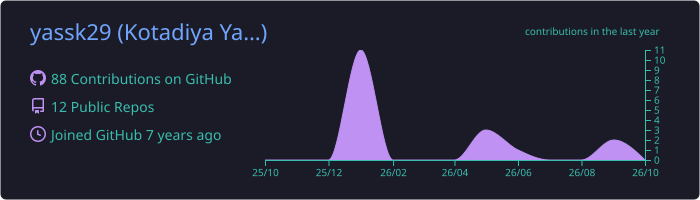
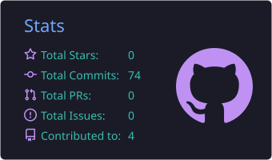
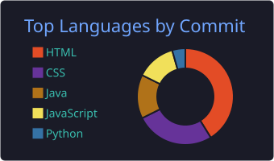

<!-- Header -->

  

  

  
  
  
  

---

### 👨‍💻 About Me

<h3 align="center">I build backend systems that move money reliably.</h3>

  Software Developer at <b>Oxyzo</b> &nbsp;·&nbsp; Java &amp; Spring Boot &nbsp;·&nbsp; Fintech integrations &nbsp;·&nbsp; Based in India 🇮🇳

  
  
  

  💡 MOTTO 
  <b><i>"Write code that solves real problems."</i></b>

---

### 🛠️ Tech Stack

  

---

### 🚀 Featured Projects

<table>
  <tr>
    <td width="50%" valign="top">
      <h4>🔐 <a href="https://github.com/yassk29/TxnVault">TxnVault</a></h4>
      
A transaction management app for securely recording and tracking financial transactions.

      
      
    </td>
    <td width="50%" valign="top">
      <h4>💳 <a href="https://github.com/yassk29/credit-card-management-system">Credit Card Management System</a></h4>
      
Backend system to manage cards, limits and transactions with a clean, layered architecture.

      
      
    </td>
  </tr>
  <tr>
    <td width="50%" valign="top">
      <h4>🛡️ <a href="https://github.com/yassk29/Network-Intrusion-Detection-System">Network Intrusion Detection System</a></h4>
      
ML-based system that classifies network traffic to detect malicious activity.

      
      
    </td>
    <td width="50%" valign="top">
      <h4>🎬 <a href="https://github.com/yassk29/Bollywood-quiz">Bollywood Quiz</a></h4>
      
An interactive quiz app — a fun build from my early JavaScript days.

      
    </td>
  </tr>
</table>

---

### 📊 GitHub Insights

  

  
  

  

---

  <i>Open to interesting conversations on backend engineering, fintech and building things from 0 → 1.</i>

  

<!---
yassk29/yassk29 is a ✨ special ✨ repository because its `README.md` (this file) appears on your GitHub profile.
You can click the Preview link to take a look at your changes.
--->
